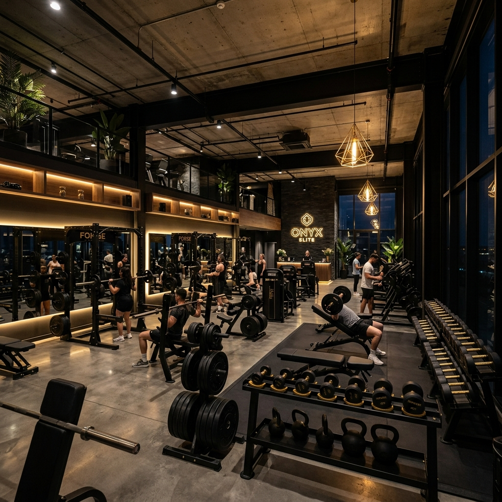

# Royal Fitness Website

A responsive website for Royal Fitness Gym in Khairpur, Sindh. Visitors can explore training services, review membership information, and try a membership application form.

[**View live demo**](https://royalfitness-iota.vercel.app/)



## Features

- Training sections for cardio, weight lifting, and personal guidance
- Membership information, operating hours, and directions
- Mobile navigation and scroll-reveal animations
- Client-side form validation and a demo confirmation with a generated reference ID

The application form runs in the browser. It displays a confirmation for demonstration and does not send or store applications.

## Run locally

```bash
git clone https://github.com/muntazirmehdibscsf24-beep/Royal-Fitness-Website.git
cd Royal-Fitness-Website
```

Open `index.html` in your browser. The project uses HTML, CSS, and vanilla JavaScript, so there is no build step. Google Fonts and Font Awesome load from external services.

## Project structure

| Path | Purpose |
| --- | --- |
| `index.html` | Page content and registration form |
| `css/style.css` | Layout, responsive styles, and animations |
| `js/main.js` | Navigation, scroll effects, and form validation |
| `assets/` | Site artwork |
